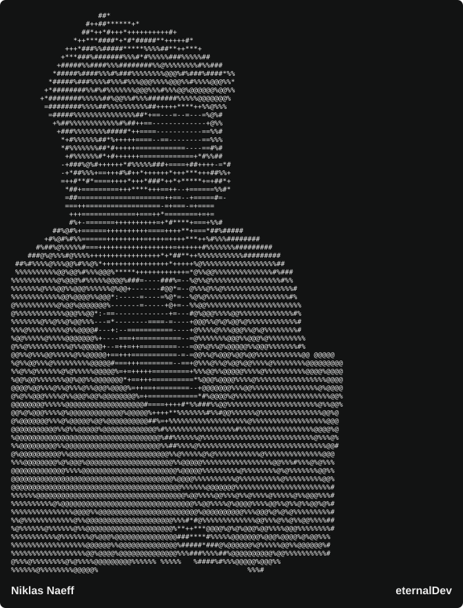

<h1 align="center">eternalDev</h1>

Web Development. Systems first, clean interfaces second.

## About me

* Niklas Naeff
* 19 Years old
* Living in Switzerland
* Studing web desing & development at the SAE Zürich

## Background

Bachelor of Science in Web Development (in progress), Switzerland.

## Interests

* Web development
* UI & UX Design
* Cars & Bikes
* Sim racing

## GitHub Activity

